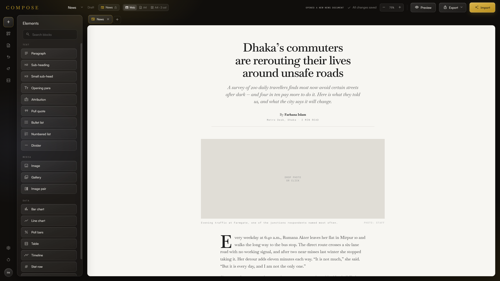
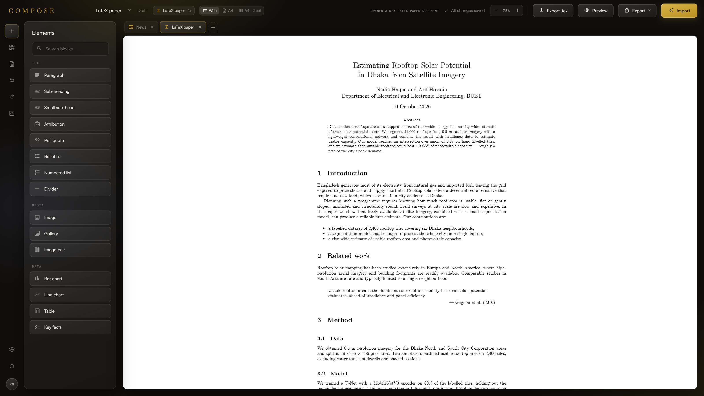

# Compose

**Import an article, let AI structure it, then edit it on the page.**



Compose is a visual feature builder that runs in the browser. Writers often have the text of an article but no easy way to turn it into a designed page. Compose reads a `.docx`, a PDF or plain text and asks an AI model to split it into blocks. You then drag elements from a palette, reorder blocks, drop in photos and format text in place.

Compose is a prototype from the [QMUL AI Hackathon](https://qmul-ai-hackathon.devpost.com/?ref_content=default&ref_feature=challenge&ref_medium=portfolio). It has no backend. Your AI key stays in your browser.

## Features

- **AI import.** Load a `.docx`, a PDF or plain text. The AI formats it into the template of your tab. PDF import also reads chapters, headings, code listings, contents pages and figures.
- **Drag to fill.** Drop a table, chart, quote or timeline beside a paragraph. The AI builds the element from that paragraph, or from the paragraphs you selected before you started to drag.
- **Five templates.** News, Finance, Research, LaTeX paper and Lab manual. Each template has its own look, allowed blocks, starter page and font preset.
- **Tabs.** Each tab is one document with its own template, content, fonts and undo history. Tabs autosave to `localStorage`.
- **Web and print layouts.** Choose one continuous page or A4 sheets with one or two columns. Paragraphs split at line breaks, headings stay with the text that follows, and figures float to the next column, as in LaTeX.
- **Export.** HTML, PDF, copied markup and, for the LaTeX template, a `.tex` project for Overleaf.
- **Keyboard and undo.** Press **?** for the shortcut list. Select a block, then press arrow keys to move between blocks, Ctrl+Shift+↑/↓ to move it, Ctrl+D to duplicate it and Delete to remove it. Deleting, closing a tab, importing and font presets show an **UNDO** link in the status bar.



## Installation

You need [Node.js](https://nodejs.org) 18 or later.

```
git clone https://github.com/PanotAbhay/Compose.git
cd Compose
npm install
npm run dev
```

Open the address that Vite prints.

## Usage

1. Open **Settings** and choose an AI provider. Enter your API key. Anthropic, OpenAI and Gemini need a key. Ollama runs on your machine and needs none.
2. Click **+** in the tab bar and pick a template. A new tab opens with that template's starter page.
3. Import an article, or edit the starter page. Drag elements from the palette onto the page.
4. Open the **Export** menu when you finish.

### Export options

| Option | Result |
|---|---|
| **Download HTML** | One `.html` file with fonts and colours embedded. It opens offline. |
| **Export PDF** | Opens the A4 pages and the print dialog. Choose **Save as PDF**. A4 layouts only. |
| **Copy HTML** | Copies the article markup to the clipboard. |
| **Export .tex** | LaTeX paper template only. Produces an `article`-class document. With photos, you get a `.zip` with `main.tex` and a `figures/` folder. |

### Commands

| Command | What it does |
|---|---|
| `npm run dev` | Starts the Vite dev server. |
| `npm run build` | Builds the app into `dist/`. |
| `npm test` | Runs the Vitest suite once. |
| `npm run test:watch` | Runs the tests again on every save. |
| `npm run share` | Builds the app and serves it at `http://127.0.0.1:4173`. |

## Documents, tabs and templates

A document's template is fixed once you choose it. To try the same content in another template, open another tab with that template.

Each template sets these values in `TEMPLATES` in `src/data/index.js`:

- **look**: CSS variables for the canvas (accent colour, paper, rules, headline font).
- **theme**: per-element style overrides. They are merged into the blocks' inline styles, so Copy HTML keeps them.
- **blocks**: the element types the palette offers and the AI may use.
- **aiRules**: extra instructions for import and drag-to-fill.
- **starter**: the demo page of the template.

Templates never hard-code type. Each template has a font preset in `TEMPLATE_FONT_PRESETS` (`src/data/fontSystems.js`), and **Settings → Fonts** adjusts the current tab only.

To add a template, add an entry to `TEMPLATES`. The picker, the menus and the prompts use it automatically.

### LaTeX paper

The template follows the LaTeX `article` class at 10pt with 1in margins. **Export .tex** converts the article into sections, an abstract, booktabs tables and pgfplots charts. Figures, tables and charts keep the size and placement they have in the editor, so the compiled PDF matches the page. The converter is `src/utils/latexExport.js`.

### Lab manual

The template handles book-length manuals. It adds:

- **Code listing**: numbered lines with SQL and Python colouring.
- **Chapter** and **Appendix**: numbered 1, 2… and A, B…, each on a new A4 page.
- **Contents**: built from chapters and headings, with page numbers in print layouts.
- **Inline code**: select text and press the button in the format bar.

### PDF import

PDF import reads structure from fonts as well as text. It writes markers into the text, and **Import as plain text** and **Format with AI** both turn them into blocks (`paraBlocks` in `src/utils/blocks.js`):

| Marker | Becomes |
|---|---|
| `# Chapter 2: …` | A chapter |
| `##` and `###` | Headings |
| ` ``` ` fences | A code listing |
| `[[toc]]` | A contents block |
| `[[image N]]` | A figure cut from the page, with its caption |

Templates without these blocks get ordinary headings and paragraphs. Pictures stay in memory until you load the next file. Autosave does not store them.

## Project layout

```
main.jsx                      entry: BrowserRouter + App
src/
├── App.jsx                   routes
├── index.css                 fonts, design tokens, editor globals
├── data/index.js             block factories, palette, templates, AI models
├── hooks/                    one concern per hook (document + undo, drag, AI fill, import, …)
├── utils/                    framework-free logic (AI providers, prompts, readers, block transforms)
└── pages/Compose/
    ├── ComposePage.jsx       owns page state, wires hooks to components
    └── components/           top bar, rail, palette, canvas, modals
        └── blocks/           one component per article block type
```

## Development

Run `npm test` and `npm run build` before you commit. Tests sit next to the code they cover. The suite covers pagination, block transforms, import (including a PDF built in the test), the LaTeX export, chart labels, every block type in every template, the canvas and the first launch.

### Add a block type

1. In `src/data/index.js`, add a factory to `NEW_BLOCK`, an entry to `PALETTE_GROUPS`, and the type to the `blocks` list of each template that should offer it.
2. Create `src/pages/Compose/components/blocks/<Name>Block.jsx`. It takes `{ block, onPatch }`.
3. Register it in `BLOCK_BODIES` in `BlockFrame.jsx`.
4. If the AI should build it from text on drop, add it to `AI_FILL_TYPES`. Then handle it in `elementToBlock` (`src/utils/blocks.js`) and describe its JSON in `elementPrompt` (`src/utils/prompts.js`).

Article blocks use inline styles on purpose. Copy HTML exports the article DOM as it is, so the markup must carry its own styles. Everything else uses co-located CSS files.

See [CLAUDE.md](CLAUDE.md) for the architecture notes and coding style.

## Sharing the app

`npm run share` serves the built app at `http://127.0.0.1:4173`. Put a tunnel in front of it to get a public HTTPS link. The link works only while your machine is awake and both commands run.

**ngrok (free account)**

1. Run `winget install ngrok.ngrok`. Sign up at dashboard.ngrok.com, then run `ngrok config add-authtoken <token>`.
2. In terminal 1, run `npm run share`. In terminal 2, run `ngrok http 127.0.0.1:4173`. If the agent does not pick up your free domain, add `--url <name>.ngrok-free.app`.

On the free plan, visitors click through an ngrok warning page once. Monthly bandwidth and request caps apply.

**Other tunnels**

| Tunnel | Command | Notes |
|---|---|---|
| Cloudflare Quick Tunnel | `cloudflared tunnel --url http://127.0.0.1:4173` | No account. The `*.trycloudflare.com` URL changes on every run. |
| VS Code port forwarding | Forward port 4173 in the Ports panel and set it to Public. | Needs a GitHub or Microsoft sign-in. |
| Tailscale Funnel | `tailscale funnel 4173` | Stable `*.ts.net` URL. Needs a Tailscale account. |
| localtunnel | `npx localtunnel --port 4173` | Nothing to install. Less reliable. |
| Pinggy | `ssh -p 443 -R0:127.0.0.1:4173 a.pinggy.io` | Nothing to install. Less reliable. |

**Static hosts** keep the app online without your machine, because the app has no backend:

- **Netlify Drop**: run `npm run build`, then drag `dist/` onto app.netlify.com/drop.
- **Vercel, Netlify or Cloudflare Pages**: import this repo with build command `npm run build` and output directory `dist`.
- **GitHub Pages**: also set `base: "/Compose/"` in `vite.config.js` and `basename={import.meta.env.BASE_URL}` on `BrowserRouter` in `main.jsx`.

List a tunnel host in `server.allowedHosts` in `vite.config.js`. Without it, Vite answers "Blocked request". Visitors enter their own AI key in Settings. The Ollama provider calls Ollama on the visitor's machine, so set `OLLAMA_ORIGINS` there to the public URL.

## License

No license file is in this repository yet. Until the team adds one, all rights stay with the authors.

## Credits

### Libraries

- [React](https://react.dev) and React DOM (MIT)
- [React Router](https://reactrouter.com) (MIT)
- [Vite](https://vitejs.dev) and [@vitejs/plugin-react](https://github.com/vitejs/vite-plugin-react) (MIT)
- [PDF.js](https://mozilla.github.io/pdf.js/) (`pdfjs-dist`), by Mozilla, for PDF import (Apache 2.0)

`.docx` import and HTML export use only browser built-ins (`DecompressionStream`). PDF.js loads only when you import a PDF.

### AI services

The app calls the model you pick in Settings, with your own key. No SDK is bundled. Requests are plain `fetch` calls in `src/utils/ai.js`.

- [Anthropic Claude API](https://docs.anthropic.com): default `claude-sonnet-4-5`. Also reads scanned PDFs.
- [OpenAI API](https://platform.openai.com/docs)
- [Google Gemini API](https://ai.google.dev): also reads scanned PDFs.
- [Ollama](https://ollama.com), running locally: default model Meta [Llama 3.1](https://www.llama.com).

### Fonts

Bundled in `src/assets/fonts/`:

- [Baskervville](https://fonts.google.com/specimen/Baskervville), by ANRT, for headlines and titles (SIL OFL 1.1)
- [Satoshi](https://www.fontshare.com/fonts/satoshi), by Indian Type Foundry via Fontshare, for interface text (Fontshare Free License)
- [Roboto Mono](https://fonts.google.com/specimen/Roboto+Mono), by Christian Robertson, for labels and data (Apache 2.0)
- [Computer Modern (CMU)](https://www.checkmyworking.com/cm-web-fonts/), by Donald Knuth, for the LaTeX paper template (SIL OFL 1.1), via the `computer-modern` npm package
- [Material Symbols Outlined](https://fonts.google.com/icons), by Google, for icons (Apache 2.0)

Loaded from [Google Fonts](https://fonts.google.com) only when you pick them in the Fonts panel (all SIL OFL 1.1):

- [Playfair Display](https://fonts.google.com/specimen/Playfair+Display), by Claus Eggers Sørensen
- [Lora](https://fonts.google.com/specimen/Lora), by Cyreal
- [Merriweather](https://fonts.google.com/specimen/Merriweather), by Sorkin Type
- [Inter](https://fonts.google.com/specimen/Inter), by Rasmus Andersson
- [DM Sans](https://fonts.google.com/specimen/DM+Sans), by Colophon Foundry
- [Space Grotesk](https://fonts.google.com/specimen/Space+Grotesk), by Florian Karsten
